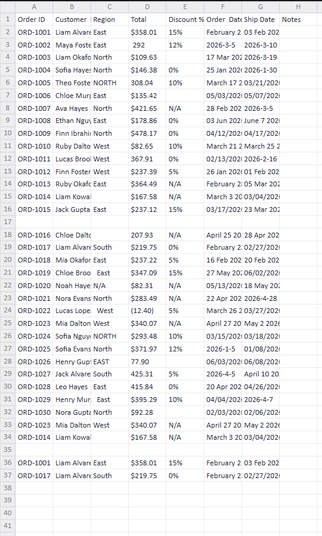
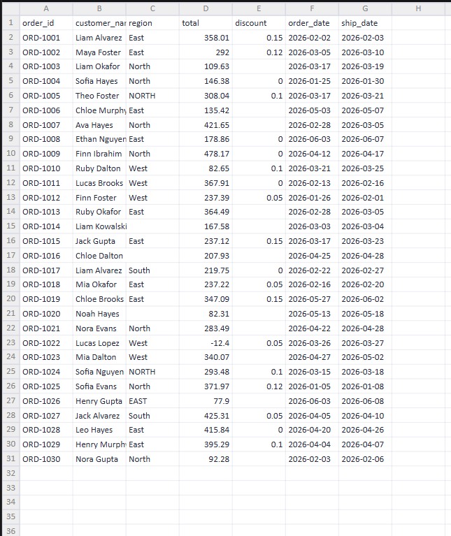

# Spreadsheet Cleaner

Turn a messy CSV or Excel export into a tidy, analysis-ready file in one command.

## The problem

Exports from accounting tools, CRMs, and order systems are rarely clean: inconsistent date formats, numbers stored as text (`"$1,234.50"`), stray spaces, `N/A` placeholders, duplicate rows, and column names like `Order  Date ` that break formulas. Fixing this by hand takes hours. This script does it in seconds.

## Before / after

| Before | After |
|---|---|
| `Order  Date ` = `03/14/2026`, `March 15 2026`, `2026-3-16` | `order_date` = `2026-03-14`, `2026-03-15`, `2026-03-16` |
| `Total` = `$1,234.50`, `(12.50)`, `12%` | `total` = `1234.5`, `-12.5`, `0.12` |
| `Region` = `  West `, `N/A`, `-` | `region` = `West`, *(blank)*, *(blank)* |
| Duplicate rows, fully empty rows | Removed |


## What it does

- Normalizes column names to `snake_case`
- Trims whitespace and turns `""`, `N/A`, `null`, `-` and similar into real blanks
- Drops fully empty rows and columns
- Converts date-like columns to ISO format (`YYYY-MM-DD`)
- Converts currency and percent text to real numbers
- Removes duplicate rows
- Prints a summary of rows in, rows out, and duplicates removed

## Installation

Requires Python 3.8+.

```bash
pip install pandas openpyxl
```

## Usage

```bash
# Writes messy_clean.csv next to the original
python clean_spreadsheet.py messy.csv

# Choose the output file (Excel works too)
python clean_spreadsheet.py messy.xlsx -o tidy.xlsx

# Force specific columns to be treated as dates
python clean_spreadsheet.py messy.csv --date-cols "Order Date,Ship Date"
```

Example output:

```
Rows in: 1,204  ->  rows out: 1,137 (67 duplicates removed)
Saved: messy_clean.csv
```

Your original file is never modified.

## Notes and limitations

- Ambiguous dates such as `03/04/2026` are parsed using pandas' default interpretation (month first). Check a few rows if your data uses day-first dates.
- A column is only converted to numbers if at least 90% of its values look numeric, so text columns are left alone.
- Always spot-check the output before using it for anything important.

## License

MIT


## Example Spreadsheet:
 
 